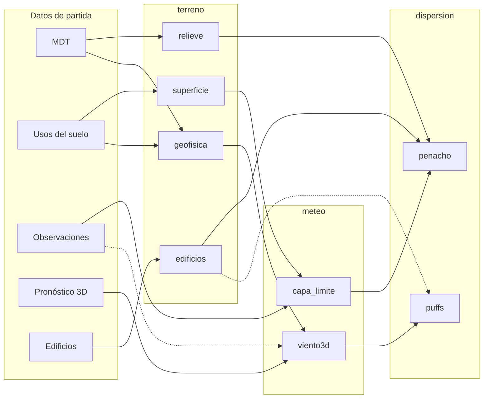

# lagaus

**Motores propios de terreno, meteorología y dispersión atmosférica, en Python.**

`lagaus` (LAGrange + GAUSS) reúne en una sola herramienta las dos familias de modelos de calidad
del aire de referencia y todo lo que necesitan para funcionar:

- **dispersión gaussiana estacionaria** (penacho), para estudios regulatorios horarios;
- **dispersión lagrangiana por puffs**, que sigue al viento variable y trata calmas y
  recirculaciones;
- el **terreno** (cotas, colinas, superficie, edificios, malla geofísica) y la **meteorología**
  (capa límite y campo de viento 3D) que los alimentan.

Cada motor reproduce a su programa de referencia y se ha validado frente a él caso a caso. No
necesita ningún ejecutable externo.

| | |
|---|---|
| Versión | **0.1.0** (2026-10-18) |
| Python | 3.11 o superior |
| Dependencias | numpy, numba, rasterio, pyproj |
| Estado | 8 motores validados dentro de su alcance; lo pendiente, en [PENDIENTES.md](PENDIENTES.md) |

---

## Los motores

| Motor | Qué hace | Equivale a | Vía | Validación frente al original |
|---|---|---|---|---|
| [`terreno.relieve`](lagaus/terreno/relieve/README.md) | cota y altura de colina de receptores y fuentes | AERMAP | traducción | 65/66 casos idénticos |
| [`terreno.superficie`](lagaus/terreno/superficie/README.md) | rugosidad, Bowen y albedo desde el uso del suelo (con adaptador CORINE) | AERSURFACE | traducción | 48/48 idénticos |
| [`terreno.edificios`](lagaus/terreno/edificios/README.md) | dimensiones de edificio por dirección para las estelas | BPIPPRM | traducción | 37/37 idénticos |
| [`terreno.geofisica`](lagaus/terreno/geofisica/README.md) | malla de usos del suelo y terreno para el campo de viento | MAKEGEO | sala limpia | 24/24 (±1 en la última cifra en 20 de ~400 000 valores) |
| [`meteo.capa_limite`](lagaus/meteo/capa_limite/README.md) | meteorología de capa límite (`.sfc`, `.pfl`) | AERMET | traducción | 73/73 pasos idénticos |
| [`meteo.viento3d`](lagaus/meteo/viento3d/README.md) | campo de viento 3D y micrometeorología | CALMET | sala limpia | 51/51 (peor 0,30° y 0,22 %) |
| [`dispersion.penacho`](lagaus/dispersion/penacho/README.md) | penacho gaussiano estacionario | AERMOD | traducción | 142 casos: 124 idénticos, 15 solo en los últimos bits, 2 solo en un volcado de depuración |
| [`dispersion.puffs`](lagaus/dispersion/puffs/README.md) | puffs lagrangianos | CALPUFF | sala limpia | 65/65 (FAC2 ≥ 0,993) |

- **Traducción**: los programas de la EPA son de dominio público. Su Fortran se ha traducido a
  Python, rutina a rutina; cada función indica la rutina original a la que equivale.
- **Sala limpia**: los demás se han reescrito desde su documentación publicada, sin abrir nunca su
  código. El ejecutable original solo se ha usado como caja negra para validar. Su equivalencia es
  funcional (opción o paso documentado), nunca por rutinas.

Detalle: [docs/equivalencias.md](docs/equivalencias.md) y [docs/validacion.md](docs/validacion.md).

## Cómo encajan



- **Cadena del penacho**: `relieve` + `superficie` + `capa_limite` (+ `edificios`) → `penacho`.
- **Cadena de los puffs**: `geofisica` + `viento3d` → `puffs`.

## Estructura del repositorio

```
lagaus/
├── README.md               este fichero
├── CHANGELOG.md            historial de versiones
├── PENDIENTES.md           lo que queda por traducir o mejorar
├── LICENSE                 licencia (propietaria)
├── pyproject.toml          paquete instalable
├── docs/
│   ├── arquitectura.md     convenciones del código, núcleo compilado, cómo añadir un motor
│   ├── equivalencias.md    motor por motor: fichero de lagaus ↔ módulo de la traducción ↔ original
│   └── validacion.md       cómo se ha validado y resultados por motor
├── lagaus/
│   ├── __main__.py         línea de órdenes: python -m lagaus <motor> …
│   ├── terreno/            relieve · superficie · edificios · geofisica
│   ├── meteo/              capa_limite · viento3d
│   └── dispersion/         penacho · puffs
├── auditor/                la puerta de entrada a main: reglas, pruebas y casos de regresión
│   ├── casos/              un caso pequeño por motor (y por opción) con su salida de referencia
│   └── pruebas/            unitarias y de regresión
└── .github/workflows/      el auditor se ejecuta en cada pull request hacia main
```

Cada carpeta tiene su `README.md`: qué hace, entradas y salidas, ejemplos de uso, validación y la
tabla de **todos sus ficheros y funciones con su definición y su equivalencia** con el programa
original.

## Instalación

```bash
git clone <url-del-repositorio> lagaus
cd lagaus
pip install -e .
```

Con conda: `conda install numpy numba rasterio pyproj` y después `pip install -e . --no-deps`.
Para las pruebas: `pip install -e ".[pruebas]"`.

## Uso rápido

Cada motor se lanza como su programa de referencia, en la carpeta del caso y con el mismo fichero
de control:

```bash
python -m lagaus relieve     caso.inp caso.out
python -m lagaus capa_limite aermet.inp
python -m lagaus edificios   entrada.inp salida.out resumen.sum
python -m lagaus penacho     caso.inp caso.out
python -m lagaus geofisica   geo.inp
python -m lagaus viento3d    CMET.INP
python -m lagaus puffs       CALPUFF.INP
python -m lagaus --version
```

Desde Python:

```python
from lagaus.dispersion.penacho.principal import ejecutar as penacho
from lagaus.meteo.viento3d.principal import ejecutar as viento3d
from lagaus.dispersion.puffs.principal import ejecutar as puffs

penacho(["caso.inp", "caso.out"])                 # listado, POSTFILE, PLOTFILE…
viento3d(["CMET.INP"], carpeta="caso_puffs")      # CALMET.DAT
cab, periodos = puffs("caso_puffs/CALPUFF.INP")   # CONC.DAT; devuelve las concentraciones
```

Si un caso pide una opción que aún no está dentro del alcance de un motor, este se para con un
mensaje claro (código de salida 2). Nunca da un resultado distinto del original sin avisar.

## Cómo se cambia el código: el auditor

Nada entra en `main` sin que el [auditor](auditor/README.md) dé **APTO**:

```bash
python -m auditor                 # reglas R1-R6 frente a main
python -m auditor --instalar-hook # audita automáticamente antes de cada push a main
```

| Regla | Qué exige |
|---|---|
| R1-R2 | el código compila y pasan todas las pruebas, unitarias y de regresión |
| R3 | las pruebas son rápidas: ≤ 20 s cada una y ≤ 300 s en conjunto (hoy, unos 15 s en total) |
| R4 | todo código nuevo o modificado trae pruebas nuevas o un caso de regresión nuevo |
| R5 | una salida de referencia solo cambia con su justificación en `auditor/CAMBIOS_REFERENCIA.md` |
| R6 | no se borra ninguna prueba ni ningún caso |

Los casos de regresión son entradas pequeñas de cada motor cuyas salidas de referencia coinciden
con las del programa original (ver [auditor/casos/README.md](auditor/casos/README.md)).

## Proyectos que lo usan

`lagaus` es el **núcleo**. Las interfaces de cada proyecto se construyen encima: la herramienta de
compostaje digicompost y la de la planta de La Galera (Tarragona). Cada proyecto descarga una
versión fija de este repositorio y le añade su interfaz, sus catálogos de fuentes y sus datos.

## Versiones

Versionado semántico. Historial en [CHANGELOG.md](CHANGELOG.md). Esta es la **v0.1.0**, la base
sobre la que se irán publicando las actualizaciones.

## Licencia

Software propietario, todos los derechos reservados (ver [LICENSE](LICENSE)). Las partes
traducidas parten de código de dominio público de la US EPA. Las reescritas en sala limpia no
contienen código de terceros. El nombre y el logotipo de la EPA no se usan para promocionar el
producto. La procedencia detallada de cada regla de los motores de sala limpia se conserva en el
repositorio privado de laboratorio.
