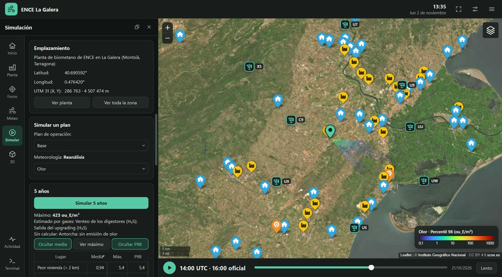
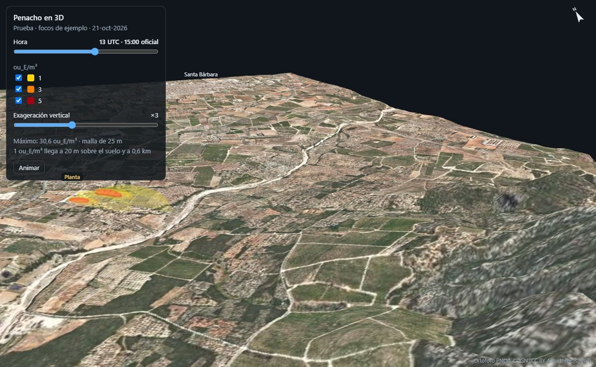
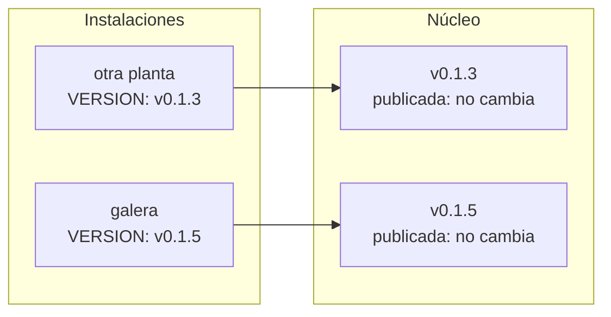

<div align="center">

# teOdors

**Simulación de la dispersión de olores y contaminantes en instalaciones industriales**

Motores de cálculo propios · Aplicación de escritorio para quien opera la planta · Un núcleo versionado y una carpeta por instalación


</div>



<sub>La aplicación de la planta de La Galera. Con focos de ejemplo y un solo día de viento repetido: la imagen enseña la herramienta, no es un resultado.</sub>

## Qué hace

teOdors responde a las preguntas que se hace quien gestiona una instalación con olores: a quién le llegan, cuánto, cuándo, y qué pasaría si cambiara su operación. Calcula
el viento sobre el terreno real, sigue lo que emite cada foco hora a hora y da los resultados en cada pueblo, vivienda o punto de interés.

| Modalidad | Pregunta que responde | Meteorología | Resultados |
|---|---|---|---|
| **Reanálisis** | ¿Cómo afecta la planta a lo largo de los años? ¿Y con otro plan de operación? | ERA5 y estaciones, varios años | Olor: media, máximo y P98. Cada gas: media, máximo y normativa. Y, si se quiere, un día con su penacho |
| **Episodio de queja** | ¿Pudo venir de la planta el olor de aquellos días? | GFS y estaciones, de 1 a 3 días | Lo mismo en esos días, con el penacho hora a hora |
| **Predicción** | ¿Cómo se comportará el olor los próximos días? | GFS, de 1 a 5 días | Lo mismo en esos días, con el penacho hora a hora |

- **Focos y planes de operación.** Cada foco, con su perfil de 24 h por días, semanas o meses. Un plan nuevo se evalúa sin volver a lanzar los motores.
- **Olor y gases.** Cada emisión se guarda en las unidades en que se mide y se convierte a las del modelo en un solo sitio. Si un foco no tiene olfatometría, el olor se estima como índice orientativo a partir de sus gases.
- **Mapas animados y visor 3D.** Penacho hora a hora, capas de media, máximo y P98, escalas de color a elegir y superficies de concentración sobre el terreno.
- **Viento a dos escalas.** Campo 3D de toda la zona y, solo para visualizar, su efecto alrededor de los edificios de la planta.
- **Normativa editable.** Los límites están en un fichero: cambiarlos no exige tocar el código.

<div align="center">
  
</div>

## Inicio rápido

Hace falta Python 3.11 o superior. La herramienta se desarrolla y se prueba en Windows.

```bash
git clone https://github.com/mcamasanz/TeOdora.git
cd TeOdora

python -m venv .venv && .venv\Scripts\activate
pip install -e "v0.1.5[gui3d]"

python galera/main.py
```

`main.py` usa siempre la versión que dice el fichero `VERSION` de su instalación, aunque haya otras instaladas. Sin la carpeta de cálculos de la planta la aplicación se abre igual, con su terreno y sus edificios, pero sin viento ni simulaciones.

## Cómo está organizado

El código común y los datos de cada instalación van por separado, y cada instalación dice qué versión del código usa.

```
TeOdora/
├── v0.1.5/                La última versión del núcleo
│   ├── core/              Motores, aplicación y descargas de datos (import teodors)
│   ├── auditor/           Reglas y pruebas que tiene que pasar cada versión
│   ├── cargador/          Usa esta versión sin instalar nada
│   └── nueva_planta.py    Crea la carpeta de una instalación
│
├── v0.1.3/                Una versión anterior, tal como se publicó
│
├── galera/                Una instalación
│   ├── VERSION            La versión del núcleo que usa
│   ├── main.py            Abre su aplicación con esa versión
│   ├── entrada/           Terreno, usos del suelo, edificios, focos, planes, receptores, normativa…
│   ├── docs/              Su documentación
│   └── 99-Test/           Sus pruebas
│
└── .github/workflows/     El auditor, en cada subida a main
```



Dos reglas sostienen todo lo demás:

1. **Una versión publicada no se vuelve a tocar.** Un cambio en el núcleo es una carpeta nueva. Una planta que funciona con la `v0.1.3` seguirá dando los mismos resultados aunque salgan versiones nuevas, hasta que se decida pasarla a otra.
2. **Una instalación no lleva código, solo datos.** Lo que sirve para más de una planta va al núcleo. Cambiar de planta es cambiar de carpeta.

**Fuera del repositorio:** los cálculos (viento de varios años, respuestas de los focos, resultados), que pesan gigas y se pueden rehacer y van a la carpeta de `rutas.json` de cada planta; las claves de API, que cada usuario guarda en su equipo; y los ejecutables de terceros.

## Instalaciones

| Instalación | Carpeta | Versión | Estado |
|---|---|---|---|
| Planta de biometano de ENCE en La Galera (Montsià, Tarragona) | [`galera/`](galera/) | `v0.1.5` | En desarrollo: focos de ejemplo y serie de viento de 5 años por terminar. Sin probar aún en el PC del operario |

## Versiones del núcleo

| Versión | Fecha | Novedades |
|---|---|---|
| [`v0.1.5`](v0.1.5/CHANGELOG.md) | 2026-11-02 | Los planes de operación guardados pasan a la carpeta de cada instalación |
| [`v0.1.3`](v0.1.3/CHANGELOG.md) | 2026-11-02 | La herramienta entera pasa al núcleo: aplicación, descargas, planes de operación, gases, normativa, visor 3D y viento local. Organización por versiones e instalaciones |
| `v0.1.2` y anteriores | hasta 2026-10-23 | Motores y utilidades, con el nombre antiguo (`odora`). En sus etiquetas de git, sin carpeta |

## Guías

<details>
<summary><b>Añadir una instalación</b></summary>

```bash
python v0.1.5/nueva_planta.py mi_planta --nombre "Mi planta" --lat 41.65 --lon 0.39 --corine ruta/CLC2018_ES.gpkg --descargar
python mi_planta/main.py --edicion
```

Crea `mi_planta/` con la versión actual, calcula el huso de esas coordenadas, descarga el terreno, los usos del suelo y los edificios y anota las estaciones cercanas. Después:

1. Revisa `entrada/planta.json` y `entrada/rutas.json`.
2. Añade los focos desde la aplicación: `--edicion` activa ese modo.
3. Añade la instalación a la tabla de arriba.

El viento alrededor de los edificios, el ejemplo de la ventana de configuración y la ortofoto del visor 3D son opcionales.

> [!NOTE]
> Los servicios de datos son los de España (terreno, edificios) y Cataluña (estaciones). En otro sitio hay que cambiarlos o añadirlos.

</details>

<details>
<summary><b>Pasar una instalación a otra versión</b></summary>

1. Cambia su fichero `VERSION`, por ejemplo a `v0.1.6`.
2. Lanza sus pruebas y compara sus resultados con los de antes.
3. Actualiza la tabla de instalaciones y sube el cambio.

Si algo va mal, volver atrás es deshacer esa línea: la versión anterior sigue en su carpeta.

</details>

<details>
<summary><b>Publicar una versión nueva del núcleo</b></summary>

1. Copia la última carpeta con el número nuevo: `v0.1.5/` → `v0.1.6/`.
2. Cambia el número en `core/__init__.py` y `pyproject.toml`, y añade la entrada en `CHANGELOG.md`.
3. Haz los cambios **solo en la carpeta nueva**.
4. Audita desde ella: `python -m auditor`. Tiene que dar **APTO**.
5. Sube a `main`, ponle la etiqueta y añádela a la tabla de versiones:

   ```bash
   git tag -a v0.1.6 -m "teOdors 0.1.6"
   git push origin main v0.1.6
   ```

</details>

## Motores

Ocho motores propios, en Python, sin ejecutables externos. Cada uno se ha validado caso a caso frente a su programa de referencia ([resultados](v0.1.5/docs/validacion.md)).

| Motor | Qué calcula | Casos de validación |
|---|---|---|
| `terreno.relieve` | Cota y altura de colina de receptores y fuentes | 65 de 66 idénticos |
| `terreno.superficie` | Rugosidad, Bowen y albedo desde el uso del suelo | 48 de 48 idénticos |
| `terreno.edificios` | Dimensiones de edificio por dirección, para las estelas | 37 de 37 idénticos |
| `terreno.geofisica` | Malla de usos del suelo y terreno para el campo de viento | 24 de 24 |
| `meteo.capa_limite` | Meteorología de capa límite | 73 de 73 pasos idénticos |
| `meteo.viento3d` | Campo de viento 3D y micrometeorología | 51 de 51 (peor: 0,30° y 0,22 %) |
| `dispersion.penacho` | Penacho gaussiano estacionario | 142 casos: 124 idénticos y 15 solo en los últimos bits |
| `dispersion.puffs` | Puffs lagrangianos, con viento variable y calmas | 65 de 65 (FAC2 ≥ 0,993) |

## Control de calidad

El **auditor** decide qué entra en `main`: se ejecuta en cada subida y se puede lanzar a mano desde la carpeta de una versión con `python -m auditor`. La `v0.1.5` tiene 705 pruebas.

| Regla | Qué exige |
|---|---|
| R1 a R3 | El código compila, pasan todas las pruebas y son rápidas |
| R4 | Todo código nuevo o modificado trae sus pruebas |
| R5 | Un resultado de referencia solo cambia si se justifica por escrito |
| R6 | No se pierde ninguna prueba respecto a la versión anterior |
| R7 | Cada carpeta se llama como su versión, una versión publicada no ha cambiado y cada planta usa una versión que existe |

## Documentación

| Para saber… | Lee |
|---|---|
| Cómo está hecho el núcleo y cómo se usa desde Python | [`v0.1.5/README.md`](v0.1.5/README.md) |
| Cómo se ha validado cada motor | [`v0.1.5/docs/validacion.md`](v0.1.5/docs/validacion.md) |
| Las reglas del auditor | [`v0.1.5/auditor/README.md`](v0.1.5/auditor/README.md) |
| Lo que queda por hacer | [`v0.1.5/PENDIENTES.md`](v0.1.5/PENDIENTES.md) |
| Los datos de La Galera y sus créditos | [`galera/README.md`](galera/README.md) |

## Licencia

Software propietario, todos los derechos reservados ([`LICENSE`](v0.1.5/LICENSE)). Las librerías de terceros, en [`THIRD-PARTY-NOTICES.md`](v0.1.5/THIRD-PARTY-NOTICES.md). Los datos de cada instalación tienen sus propias condiciones, citadas en el `README.md` de su carpeta.
