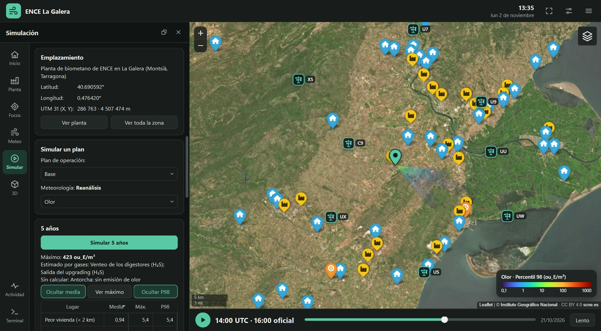

# La Galera

Planta de biometano de ENCE en La Galera (Montsià, Tarragona), en 40,6905923 N y 0,4764197 E. La versión de teOdors que usa está en [`VERSION`](VERSION).



<sub>Con focos de ejemplo y un solo día de viento repetido: la imagen enseña la herramienta, no es un resultado.</sub>

⚠️ **Los 13 focos de `entrada/focos.json` son de ejemplo:** posiciones leídas a ojo en la ortofoto y valores inventados, a la espera de la visita a la planta. Lo que se calcule
con ellos prueba la herramienta, pero no es un resultado. La normativa de `entrada/normativa.json` también es preliminar. La serie de viento de 5 años (2021-2025, 60 meses) está completa desde el 2026-11-06, en la carpeta de cálculos: en 6 meses, las horas en que no había ninguna estación de Meteocat (de 1 a 19 h seguidas) llevan la temperatura, la humedad y la presión del ERA5 (ver el `CHANGELOG` de la `v0.1.7`).

## Abrir la aplicación

```bash
python main.py                  # modo operario: consulta los focos y crea planes de operación
python main.py --circe          # además, añade y cambia focos
```

También `--dia AAAA-MM-DD`, `--focos` y `--planes`. Sin la carpeta de cálculos se abre igual, con el terreno, los edificios y el viento de `viento/`, pero sin simulaciones.

## Datos de entrada: `entrada/`

| Qué | Dónde | De dónde sale |
|---|---|---|
| Identidad, huso (EPSG:25831), dominio de 50 × 50 km, malla de receptores y el interruptor del cálculo en paralelo (`operacion.paralelo`, apagado) | `planta.json` | decisiones de proyecto, explicadas en sus notas |
| Coordenadas | `emplazamiento.json` | fijas, no se cambian desde la aplicación |
| Cotas, a 25 m | `terreno/40.69059_0.47642_50km_25m/elevacion.tif` | MDT del IGN |
| Usos del suelo | `terreno/…/usos.tif`, `terreno/…/corine.gpkg` | CORINE Land Cover 2018, recortado y pasado a rejilla |
| Núcleos de población | `terreno/…/nucleos_nombres.json` | CORINE, con los nombres de CartoCiudad |
| Edificios a menos de 2 km (867) | `edificios/40.69059_0.47642_r2km/edificios.gpkg` | Catastro: solo huella, uso y plantas |
| Focos | `focos.json` | ⚠️ de ejemplo |
| Planes de operación guardados | `planes/` | los crea quien opera la planta, desde la aplicación. Aún no hay ninguno |
| Receptores con nombre (Dacame) | `receptores.json` | Catastro |
| Límites | `normativa.json` | ⚠️ preliminar |
| Ejemplo de la ventana de configuración | `recursos/ejemplo/` | una hora de viento y de penacho, con los focos de ejemplo. No es un resultado |
| Ortofoto del visor 3D | `recursos/visor3d/ortofoto.jpg` | PNOA, ±3,2 km |

## El viento: `viento/`

Junto a `entrada/`, para tener el viento sin la carpeta de cálculos (o en la de `ENCE_GALERA_VIENTO`, si está puesta).

| Qué | Dónde | De dónde sale |
|---|---|---|
| Viento 3D de la serie del reanálisis (2021-2025, 60 meses), 714 MB | `viento/3d/`: un `AAAAMM.vz` por mes, `bases/` e `indice.json` | los .cmz de la carpeta de cálculos (27 GB), comprimidos con `teodors.casos.viento3d.construir_paquete` (patrones POD y correcciones: U y V a ±0,25 m/s). Se usa si no está el .cmz del mes |
| Viento alrededor de los edificios, 36 direcciones | `viento/local/viento_local.npz` (ruta en `planta.json`, `viento_local.biblioteca`) | calculado con el LiDAR de al lado. ⚠️ No validado: solo enseña el efecto de los edificios |
| LiDAR de la planta, a 1 m | `viento/local/planta_1m.npz` (ruta en `planta.json`, `viento_local.lidar`) | ICGC; solo hace falta para rehacer el viento local |

Los meses nuevos de la serie (otro año) se suman al paquete sin rehacerlo: `teodors.casos.viento3d.anadir_paquete()`.

## La meteo de los informes: `meteo/`

Junto a `entrada/`, la meteorología que necesitan los informes, ya procesada (desde la `v0.1.10`), unos 5 MB. Con ella, un equipo sin la carpeta de cálculos hace los informes completos, sin ningún fichero meteorológico en bruto:

- las estaciones de la zona;
- la rosa de los vientos de cada estación y la del ERA5;
- el tiempo en la planta, día a día;
- lo normal de cada fecha y hora en las estaciones (2021-2025).

El índice y un `LEEME.md` dicen de dónde sale cada fichero. Se rehace con `python -m teodors.operacion.meteo_planta`, en el equipo que tiene la meteo en bruto.

## La dispersión: `dispersion/`

Las respuestas de los focos (concentración por g/s emitido, por hora de emisión) de todos los días de la serie, comprimidas: es lo que lee el reanálisis de un
plan, que así no lanza el motor. Una carpeta por foco y un fichero por mes, ~56 kB por foco y día (con 13 focos, 5 años en ~1,3 GB). ⚠️ Aún no está: se
calculará cuando los focos estén cerrados (`python -m teodors.operacion.respuestas` en cada día y `python -m teodors.operacion.serie_respuestas` para
empaquetarlos aquí). El reanálisis cuenta del primer al último día que haya, sobre las horas simuladas.

## Los cálculos y las claves

Lo que no viaja con la instalación (meteorología, MOS, validaciones, logs y la caché del viento 3D de la serie) va a una carpeta **`datos/` dentro de la instalación**, que no se versiona. Para tenerlo en otro disco —una unidad de red, por ejemplo— basta la variable de entorno `ENCE_GALERA_DATOS` (tiene prioridad) o editar `entrada/rutas.json`. Los cálculos en marcha van a una carpeta temporal del sistema.

Las **claves de API no van aquí nunca**: cada usuario las pone en su propio equipo, en `%APPDATA%\CIRCE\claves` (p. ej. `cds-api-key.txt` para el CDS de Copernicus). Así no viajan con la instalación ni entran al repositorio.

Tareas, con `PYTHONPATH=../v0.1.10/cargador` y `TEODORS_PLANTA=entrada`:

| Para qué | Orden |
|---|---|
| Serie de viento de varios años | `python -m teodors.operacion.viento3d_series` |
| Rehacer el viento local, si cambian los edificios | `python -m teodors.operacion.viento_local_biblioteca` |
| De las nubes LiDAR a sus rejillas de 1 m | `python -I ../v0.1.10/core/fuentes/lidar.py <carpeta .laz> <carpeta de las librerías> viento/local/planta_1m.npz 286512 4507400 600` |

## Pruebas y documentación del proyecto

No van en el repositorio, que solo lleva la instalación: las pruebas (`99-Test/`), la documentación (`docs/`) y las decisiones tomadas
(`CLAUDE.md`) están en el equipo de quien mantiene la planta.

## Créditos de los datos

| Dato | Crédito | Condiciones |
|---|---|---|
| MDT y ortofoto PNOA | © Instituto Geográfico Nacional de España | CC BY 4.0, [scne.es](https://www.scne.es) |
| Usos del suelo | CORINE Land Cover 2018, Copernicus Land Monitoring Service ([doi:10.2909/71c95a07-e296-44fc-b22b-415f42acfdf0](https://doi.org/10.2909/71c95a07-e296-44fc-b22b-415f42acfdf0)), con su copia del IGN | Atribución. **Transformado:** recortado a 50 × 50 km y pasado a rejilla de 25 m |
| Edificios | © Dirección General del Catastro | Solo el dato transformado: huella, uso y plantas, no el GML original |
| Nombres de los núcleos | CartoCiudad, © Instituto Geográfico Nacional | CC BY 4.0 |
| Alturas de los edificios de la planta | LiDAR del Institut Cartogràfic i Geològic de Catalunya | Atribución |
