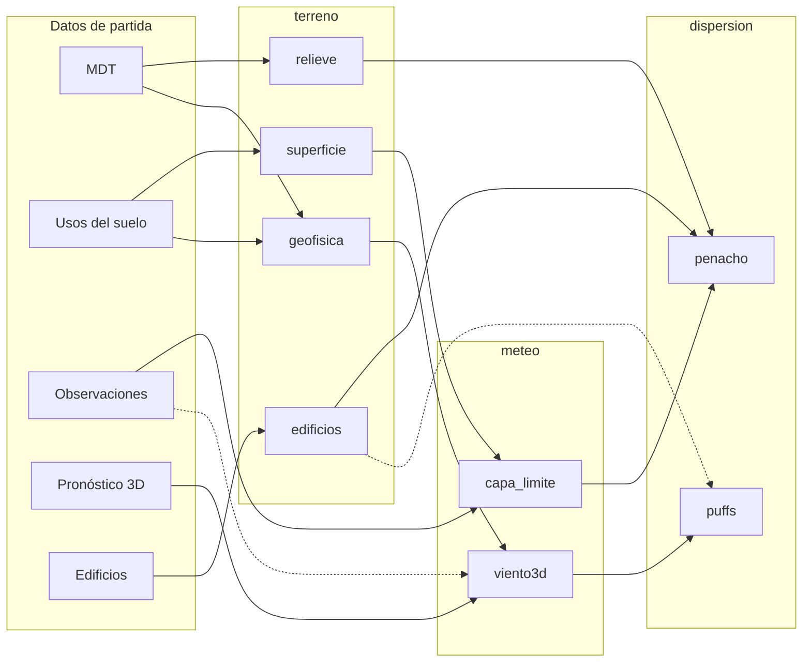

# teOdors

**Motores propios de terreno, meteorología y dispersión atmosférica, en Python.**

`teodors` (del latín *odor*, olor) reúne en una sola herramienta las dos familias de modelos de
calidad del aire de referencia y todo lo que necesitan para funcionar. Nace para los estudios de
impacto por olores (compostaje, biometano, industria), pero sirve para cualquier contaminante:

- **dispersión gaussiana estacionaria** (penacho), para estudios regulatorios horarios;
- **dispersión lagrangiana por puffs**, que sigue al viento variable y trata calmas y
  recirculaciones;
- el **terreno** (cotas, colinas, superficie, edificios, malla geofísica) y la **meteorología**
  (capa límite y campo de viento 3D) que los alimentan.

Cada motor reproduce a su programa de referencia y se ha validado frente a él caso a caso. No
necesita ningún ejecutable externo.

| | |
|---|---|
| Versión | **0.1.12** (sin publicar) |
| Python | 3.11 o superior |
| Dependencias | numpy, numba, rasterio, pyproj (y pandas para `preparacion`: `teodors[preparacion]`; scipy para `meteo.viento_local`: `teodors[viento_local]`; las descargas: `teodors[fuentes]`; las métricas: `teodors[preparacion,mapas]`; los casos y la operación de una planta: `teodors[fuentes]`; el penacho en 3D: `teodors[penacho_3d]`; el MOS: `teodors[mos]`; la interfaz: `teodors[gui]`, y con el penacho en 3D, `teodors[gui3d]`) |
| Estado | 8 motores validados dentro de su alcance; lo pendiente, en [PENDIENTES.md](PENDIENTES.md) |

---

## Los motores

| Motor | Qué hace | Equivale a | Vía | Validación frente al original |
|---|---|---|---|---|
| [`terreno.relieve`](core/terreno/relieve/README.md) | cota y altura de colina de receptores y fuentes | AERMAP | traducción | 65/66 casos idénticos |
| [`terreno.superficie`](core/terreno/superficie/README.md) | rugosidad, Bowen y albedo desde el uso del suelo (con adaptador CORINE) | AERSURFACE | traducción | 48/48 idénticos |
| [`terreno.edificios`](core/terreno/edificios/README.md) | dimensiones de edificio por dirección para las estelas | BPIPPRM | traducción | 37/37 idénticos |
| [`terreno.geofisica`](core/terreno/geofisica/README.md) | malla de usos del suelo y terreno para el campo de viento | MAKEGEO | sala limpia | 24/24 (±1 en la última cifra en 20 de ~400 000 valores) |
| [`meteo.capa_limite`](core/meteo/capa_limite/README.md) | meteorología de capa límite (`.sfc`, `.pfl`) | AERMET | traducción | 73/73 pasos idénticos |
| [`meteo.viento3d`](core/meteo/viento3d/README.md) | campo de viento 3D y micrometeorología | CALMET | sala limpia | 51/51 (peor 0,30° y 0,22 %) |
| [`dispersion.penacho`](core/dispersion/penacho/README.md) | penacho gaussiano estacionario | AERMOD | traducción | 142 casos: 124 idénticos, 15 solo en los últimos bits, 2 solo en un volcado de depuración |
| [`dispersion.puffs`](core/dispersion/puffs/README.md) | puffs lagrangianos | CALPUFF | sala limpia | 65/65 (FAC2 ≥ 0,993) |

- **Traducción**: los programas de la EPA son de dominio público. Su Fortran se ha traducido a
  Python, rutina a rutina; cada función indica la rutina original a la que equivale.
- **Sala limpia**: los demás se han reescrito desde su documentación publicada, sin abrir nunca su
  código. El ejecutable original solo se ha usado como caja negra para validar. Su equivalencia es
  funcional (opción o paso documentado), nunca por rutinas.

Detalle: [docs/equivalencias.md](docs/equivalencias.md) y [docs/validacion.md](docs/validacion.md).

## Cómo encajan



- **Cadena del penacho**: `relieve` + `superficie` + `capa_limite` (+ `edificios`) → `penacho`.
- **Cadena de los puffs**: `geofisica` + `viento3d` → `puffs`.

## Estructura del repositorio

```
v0.1.12/                    una versión del núcleo: una vez publicada, no se toca
├── README.md               este fichero
├── CHANGELOG.md            historial de versiones
├── PENDIENTES.md           lo que queda por traducir o mejorar
├── LICENSE                 licencia (propietaria)
├── THIRD-PARTY-NOTICES.md  librerías de terceros
├── pyproject.toml          paquete instalable
├── cargador/               «import teodors» con esta versión, sin instalar nada
├── nueva_planta.py         crea la carpeta de una planta nueva
├── docs/
│   ├── arquitectura.md     convenciones del código, núcleo compilado, cómo añadir un motor
│   ├── equivalencias.md    motor por motor: fichero de teOdors ↔ módulo de la traducción ↔ original
│   └── validacion.md       cómo se ha validado y resultados por motor
├── core/                   el código: se instala e importa como `teodors`
│   ├── comun/              utilidades comunes (UTM, convergencia): no son motores
│   ├── planta/             lo que se sabe de un emplazamiento, leído de su carpeta
│   ├── fuentes/            descargas de terreno, usos, edificios, estaciones, ERA5 y GFS (servicios de España, salvo ERA5 y GFS)
│   ├── metricas/           validación del viento frente a las estaciones: métricas, rosas y control de calidad
│   ├── preparacion/        entradas y control de los motores (viento3d, puffs), receptores
│   ├── casos/              los casos de una planta: une su carpeta, sus datos y los motores
│   ├── operacion/          de los focos y los planes de una planta a sus resultados, sin interfaz
│   ├── mos/                corrección estadística de la predicción de GFS en cada estación
│   ├── gui/                la aplicación de escritorio de una planta (extra `gui`)
│   ├── __main__.py         línea de órdenes: python -m teodors <motor> …
│   ├── terreno/            relieve · superficie · edificios · geofisica
│   ├── meteo/              capa_limite · viento3d · viento_local (no validado, no es un motor)
│   └── dispersion/         penacho · puffs
└── auditor/                la puerta de entrada a main: reglas, pruebas y casos de regresión
    ├── casos/              un caso pequeño por motor (y por opción) con su salida de referencia
    └── pruebas/            unitarias y de regresión
```

Cómo se organizan las versiones y las plantas, en el `README.md` de la raíz del repositorio. Cada carpeta tiene su `README.md`: qué hace, entradas y salidas, ejemplos de uso, validación y la
tabla de **todos sus ficheros y funciones con su definición y su equivalencia** con el programa
original.

## Instalación

```bash
git clone https://github.com/mcamasanz/TeOdora.git
cd TeOdora/v0.1.12
pip install -e .
```

Con conda: `conda install numpy numba rasterio pyproj` y después `pip install -e . --no-deps`.
Para las pruebas: `pip install -e ".[pruebas]"`.

El código está en la carpeta `core/` y se importa como `teodors`. Esa correspondencia la establece la instalación o, sin
instalar nada, la carpeta `cargador/` en el camino de Python: así eligen su versión las plantas.

## Uso rápido

Cada motor se lanza como su programa de referencia, en la carpeta del caso y con el mismo fichero
de control:

```bash
python -m teodors relieve     caso.inp caso.out
python -m teodors capa_limite aermet.inp
python -m teodors edificios   entrada.inp salida.out resumen.sum
python -m teodors penacho     caso.inp caso.out
python -m teodors geofisica   geo.inp
python -m teodors viento3d    CMET.INP
python -m teodors puffs       CALPUFF.INP
python -m teodors --version
```

Desde Python:

```python
from teodors.dispersion.penacho.principal import ejecutar as penacho
from teodors.meteo.viento3d.principal import ejecutar as viento3d
from teodors.dispersion.puffs.principal import ejecutar as puffs

penacho(["caso.inp", "caso.out"])                 # listado, POSTFILE, PLOTFILE…
viento3d(["CMET.INP"], carpeta="caso_puffs")      # CALMET.DAT
cab, periodos = puffs("caso_puffs/CALPUFF.INP")   # CONC.DAT; devuelve las concentraciones
```

Si un caso pide una opción que aún no está dentro del alcance de un motor, este se para con un
mensaje claro (código de salida 2). Nunca da un resultado distinto del original sin avisar.

## Cómo se cambia el código: el auditor

Nada entra en `main` sin que el [auditor](auditor/README.md) dé **APTO**:

```bash
python -m auditor                 # desde esta carpeta: reglas R1-R7, frente a la versión anterior
python -m auditor --instalar-hook # audita automáticamente antes de cada push a main
```

| Regla | Qué exige |
|---|---|
| R1-R2 | el código compila y pasan todas las pruebas, unitarias y de regresión |
| R3 | las pruebas son rápidas: ≤ 20 s cada una y ≤ 300 s en conjunto (hoy, unos 90 s en total) |
| R4 | todo código nuevo o modificado trae pruebas nuevas o un caso de regresión nuevo |
| R5 | una salida de referencia solo cambia con su justificación en `auditor/CAMBIOS_REFERENCIA.md` |
| R6 | no se borra ninguna prueba ni ningún caso |
| R7 | cada carpeta se llama como su versión, una publicada no se toca y cada planta usa una versión que existe |

Los casos de regresión son entradas pequeñas de cada motor cuyas salidas de referencia coinciden
con las del programa original (ver [auditor/casos/README.md](auditor/casos/README.md)).

## Proyectos que lo usan

`teodors` es el **núcleo**. La herramienta de compostaje digicompost construye su interfaz encima. Las plantas usan la de
`teodors.gui` (extra `gui`): una planta es su carpeta, al lado de las versiones, con sus datos de entrada y un fichero `VERSION`
con la versión que usa. Qué versión usa cada una, en el `README.md` de la raíz.

## Versiones

Versionado semántico. Historial en [CHANGELOG.md](CHANGELOG.md). Desde la **v0.1.3**, cada versión exacta es una carpeta; las
anteriores siguen en sus etiquetas de git, en la raíz de cada una.

## Licencia

Software propietario, todos los derechos reservados (ver [LICENSE](LICENSE)). Las partes
traducidas parten de código de dominio público de la US EPA. Las reescritas en sala limpia no
contienen código de terceros. El nombre y el logotipo de la EPA no se usan para promocionar el
producto. La procedencia detallada de cada regla de los motores de sala limpia se conserva en el
repositorio privado de laboratorio.
